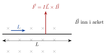

<!-- video: kommer (videoer/ingeniorfysikk/15-03-kraft-pa-leder) -->
{fig-alt="Video kommer"}

<!-- tillegg: Claude -->
En strøm er ladninger i bevegelse. Når hver ladning får en kraft i et magnetfelt, får hele ledningen en kraft. Det er denne kraften som driver elektromotorer, høyttalere og harddisker. Her finner vi et enkelt uttrykk for den.

## Kraften på en rett leder

{.tikz-fig style="width:440px"}

<!-- tillegg: Claude -->
En leder med lengde $L$ og tverrsnitt $A$ har $nAL$ ladningsbærere, hver med ladning $q$ og driftsfart $\vec v_d$. Hver får kraften $q\vec v_d\times\vec B$. Den samlede kraften er
$$
\vec F = nAL\,q\,\vec v_d\times\vec B
$$
Men $nqv_dA = I$ (se *elektrisk strøm*). Vi lar $\vec L$ være en vektor med lengden $L$ som peker i strømretningen, og får

::: {.callout-important title="Kraft på en strømførende leder"}
<!-- tillegg: Claude -->
$$
\vec F = I\,\vec L\times\vec B, \qquad F = ILB\sin\theta
$$
der $\theta$ er vinkelen mellom lederen (strømretningen) og feltet.
:::

<!-- tillegg: Claude -->
Høyrehåndsregelen gir retningen: fingrene langs strømmen, bøy mot feltet, tommelen langs kraften. Lederen får ingen kraft når den ligger langs feltet.

For en krum leder deler vi den i små biter $\mathrm{d}\vec l$ og summerer: $\vec F = I\int\mathrm{d}\vec l\times\vec B$. I et homogent felt gir det et nyttig resultat: Kraften på en krum leder er den samme som på en rett leder mellom de samme endepunktene. Kraften på en **lukket** sløyfe i et homogent felt er derfor null. (Men den kan likevel få et dreiemoment, se *dreiemoment på strømsløyfe*.)

::: {.eksempel}
<!-- tillegg: Claude -->
**Eksempel: Leder i magnetfelt.** En leder på $0.50\ \mathrm{m}$ fører strømmen $4.0\ \mathrm{A}$ i et magnetfelt på $0.30\ \mathrm{T}$. Finn kraften når lederen står vinkelrett på feltet og når vinkelen er $30^\circ$.

::: {.losning}
$$
F_{90} = ILB = 4.0\cdot0.50\cdot0.30\ \mathrm{N} = \underline{\underline{0.60\ \mathrm{N}}}, \qquad F_{30} = ILB\sin30^\circ = \underline{\underline{0.30\ \mathrm{N}}}
$$
:::
:::

::: {.eksempel}
<!-- tillegg: Claude -->
**Eksempel: En svevende ledning.** En vannrett ledning med masse $20\ \mathrm{g}$ per meter ligger i et vannrett magnetfelt på $0.50\ \mathrm{T}$, vinkelrett på ledningen. Hvor stor strøm trengs for at ledningen skal sveve? Hvilken vei må strømmen gå hvis feltet peker inn i arket?

::: {.losning}
Den magnetiske kraften må bære tyngden: $ILB = m\mathrm{g}$. Per meter:
$$
I = \frac{(m/L)\mathrm{g}}{B} = \frac{0.020\cdot9.81}{0.50}\ \mathrm{A} = \underline{\underline{0.39\ \mathrm{A}}}
$$
Kraften må peke opp. Med feltet inn i arket gir $\vec L\times\vec B$ oppover når strømmen går **mot høyre**.
:::
:::

## Bruk i praksis

::: {.kort}
- **Høyttaleren.** En spole er festet til membranen og sitter i feltet fra en permanentmagnet. Vekselstrøm i spolen gir en kraft som skifter retning i takt med musikken.
- **Elektromotoren.** En sløyfe i et magnetfelt får krefter som dreier den. Se *dreiemoment på strømsløyfe*.
- **Skinnekanonen.** En leder glir på to skinner. En stor strøm gir en kraft som skyter den ut med stor fart.
:::

:::: {.oppgaver}

::: {.oppgave tittel="Kraften på en kraftlinje"}
<!-- tillegg: Claude -->
En kraftlinje fører $500\ \mathrm{A}$ vinkelrett på jordas magnetfelt ($5.0\cdot10^{-5}\ \mathrm{T}$). Hvor stor er kraften per meter?

::: {.losning}
$$
\frac FL = IB = 500\cdot5.0\cdot10^{-5}\ \mathrm{N/m} = \underline{\underline{2.5\cdot10^{-2}\ \mathrm{N/m}}}
$$
Svært liten sammenlignet med tyngden av ledningen.
:::
:::

::: {.oppgave tittel="Retning"}
<!-- tillegg: Claude -->
En loddrett ledning har strøm oppover. Magnetfeltet peker mot øst. Hvilken vei virker kraften?

::: {.losning}
$\vec L$ opp, $\vec B$ mot øst. Med høyrehåndsregelen: fingrene opp, bøy mot øst, tommelen peker mot **nord**. (Sjekk med koordinater: opp $= \hat z$, øst $= \hat x$, $\hat z\times\hat x = \hat y$ = nord.)
:::
:::

::: {.oppgave tittel="Skinnekanon" niva="Middels"}
<!-- tillegg: Claude -->
En metallstang på $50\ \mathrm{g}$ ligger tvers over to vannrette skinner som er $20\ \mathrm{cm}$ fra hverandre, i et loddrett magnetfelt på $0.80\ \mathrm{T}$. Det går $25\ \mathrm{A}$ gjennom stanga. Hvor stor akselerasjon får den? Se bort fra friksjon.

::: {.losning}
$$
F = ILB = 25\cdot0.20\cdot0.80\ \mathrm{N} = 4.0\ \mathrm{N}, \qquad a = \frac Fm = \frac{4.0}{0.050}\ \mathrm{m/s^2} = \underline{\underline{80\ \mathrm{m/s^2}}}
$$
:::
:::

::: {.oppgave tittel="Halvsirkel" niva="Utfordrende"}
<!-- tillegg: Claude -->
En leder er bøyd til en halvsirkel med radius $R$ og fører strømmen $I$. Den ligger i et homogent felt $B$ som står vinkelrett på planet til halvsirkelen. Hva er den samlede kraften?

::: {.losning}
Kraften er den samme som på en rett leder mellom endepunktene. Avstanden mellom endepunktene er diameteren $2R$, og den står vinkelrett på feltet:
$$
F = I\cdot2R\cdot B = \underline{\underline{2IRB}}
$$
(Det kan også vises med integralet: Komponentene langs diameteren opphever hverandre, og komponentene vinkelrett summeres til $\int_0^\pi IBR\sin\phi\,\mathrm{d}\phi = 2IRB$.)
:::
:::

::::
