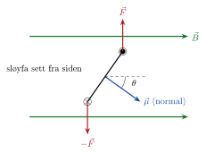

<!-- video: kommer (videoer/ingeniorfysikk/15-04-dreiemoment-pa-stromsloyfe) -->
{fig-alt="Video kommer"}

<!-- tillegg: Claude -->
En lukket strømsløyfe i et homogent magnetfelt får ingen netto kraft. Likevel snur den seg! Kreftene på to av sidene trekker i hver sin retning og gir et **dreiemoment**. Det er dette som får elektromotorer til å gå rundt, og det er også grunnen til at en kompassnål stiller seg langs feltet.

## Rektangulær sløyfe

{.tikz-fig style="width:440px"}

<!-- tillegg: Claude -->
En rektangulær sløyfe har sider $a$ og $b$ og fører strømmen $I$. Den kan dreie om en akse gjennom midten. De to sidene med lengde $a$ står vinkelrett på feltet og får kraften $F = IaB$, i hver sin retning. Kreftene på de andre to sidene opphever hverandre og gir heller ikke dreiemoment.

La $\theta$ være vinkelen mellom normalen til sløyfa og feltet. Hver av de to kreftene har armen $\tfrac b2\sin\theta$. Det samlede dreiemomentet blir
$$
\tau = 2\cdot IaB\cdot\frac b2\sin\theta = IabB\sin\theta = IAB\sin\theta
$$
der $A = ab$ er arealet. Resultatet gjelder for plane sløyfer med hvilken som helst form.

## Magnetisk dipolmoment

::: {.callout-note title="Definisjon: Magnetisk dipolmoment"}
<!-- tillegg: Claude -->
En plan strømsløyfe med strømmen $I$, arealet $A$ og $N$ vindinger har det **magnetiske dipolmomentet**
$$
\vec\mu = NIA\,\hat n
$$
der $\hat n$ er normalen til sløyfa, gitt ved høyrehåndsregelen: Bøy fingrene langs strømmen, så peker tommelen langs $\hat n$. Enheten er $\mathrm{A\,m^2}$.
:::

::: {.callout-important title="Dreiemoment og energi for en dipol i et magnetfelt"}
<!-- tillegg: Claude -->
$$
\vec\tau = \vec\mu\times\vec B, \qquad \tau = \mu B\sin\theta, \qquad U = -\vec\mu\cdot\vec B = -\mu B\cos\theta
$$
:::

<!-- tillegg: Claude -->
Dreiemomentet vil vri $\vec\mu$ slik at den peker langs $\vec B$. Da er energien lavest, $U = -\mu B$. En kompassnål er en liten magnetisk dipol, og den stiller seg nettopp langs feltet. Det er den samme matematikken som for en elektrisk dipol i et elektrisk felt.

::: {.eksempel}
<!-- tillegg: Claude -->
**Eksempel: Spole i magnetfelt.** En kvadratisk spole med sider $5.0\ \mathrm{cm}$ har 100 vindinger og fører $0.50\ \mathrm{A}$. Den står i et magnetfelt på $0.20\ \mathrm{T}$.

**a)** Hva er dipolmomentet?\
**b)** Hva er det største dreiemomentet?\
**c)** Hvor mye arbeid må til for å vri spolen fra laveste til høyeste energi?

::: {.losning}
**a)**
$$
\mu = NIA = 100\cdot0.50\cdot(0.050)^2\ \mathrm{A\,m^2} = \underline{\underline{0.13\ \mathrm{A\,m^2}}}
$$
**b)** Størst når $\theta = 90^\circ$:
$$
\tau_\mathrm{maks} = \mu B = 0.125\cdot0.20\ \mathrm{N\,m} = \underline{\underline{0.025\ \mathrm{N\,m}}}
$$
**c)** Fra $\theta = 0$ ($U = -\mu B$) til $\theta = 180^\circ$ ($U = +\mu B$):
$$
W = \Delta U = 2\mu B = 2\cdot0.125\cdot0.20\ \mathrm{J} = \underline{\underline{0.050\ \mathrm{J}}}
$$
:::
:::

## Elektromotoren

<!-- tillegg: Claude -->
I en likestrømsmotor sitter en spole mellom polene på en magnet. Dreiemomentet vrir spolen mot $\theta = 0$. Rett før den kommer dit, snur en **kommutator** (en delt kontaktring) strømretningen. Da peker $\vec\mu$ plutselig motsatt vei, og dreiemomentet fortsetter å vri spolen samme vei. Slik går motoren rundt og rundt.

Når motoren går, induseres det også en spenning i spolen som virker mot strømmen. Den kalles **mot-emf** og er tema under *generator og motor*.

:::: {.oppgaver}

::: {.oppgave tittel="Sirkulær sløyfe"}
<!-- tillegg: Claude -->
En sirkulær sløyfe med radius $3.0\ \mathrm{cm}$ fører $2.0\ \mathrm{A}$. Hva er dipolmomentet?

::: {.losning}
$$
\mu = IA = 2.0\cdot\pi(0.030)^2\ \mathrm{A\,m^2} = \underline{\underline{5.7\cdot10^{-3}\ \mathrm{A\,m^2}}}
$$
:::
:::

::: {.oppgave tittel="Når er dreiemomentet null?"}
<!-- tillegg: Claude -->
For hvilke vinkler er dreiemomentet på en strømsløyfe null? Hvilken av dem er stabil?

::: {.losning}
$\tau = \mu B\sin\theta = 0$ for $\theta = 0$ og $\theta = 180^\circ$. Ved $\theta = 0$ er energien lavest, og en liten utvridning gir et dreiemoment tilbake: **stabil**. Ved $180^\circ$ er energien høyest, og en liten utvridning gir et dreiemoment som vrir den videre bort: ustabil.
:::
:::

::: {.oppgave tittel="Måle magnetfeltet" niva="Middels"}
<!-- tillegg: Claude -->
En spole med 50 vindinger og areal $4.0\ \mathrm{cm^2}$ fører $0.20\ \mathrm{A}$. Det største dreiemomentet måles til $2.4\cdot10^{-4}\ \mathrm{N\,m}$. Hvor sterkt er magnetfeltet?

::: {.losning}
$$
B = \frac{\tau_\mathrm{maks}}{NIA} = \frac{2.4\cdot10^{-4}}{50\cdot0.20\cdot4.0\cdot10^{-4}}\ \mathrm{T} = \underline{\underline{0.060\ \mathrm{T}}}
$$
:::
:::

::: {.oppgave tittel="Elektronet som magnet" niva="Utfordrende"}
<!-- tillegg: Claude -->
I Bohrs atommodell går elektronet i hydrogen i en sirkel med radius $5.3\cdot10^{-11}\ \mathrm{m}$ og farten $2.2\cdot10^{6}\ \mathrm{m/s}$. Regn ut strømmen dette svarer til, og dipolmomentet.

::: {.losning}
Omløpstiden er $T = 2\pi r/v = 1.51\cdot10^{-16}\ \mathrm{s}$. Strømmen er ladning per tid:
$$
I = \frac{\mathrm{e}}{T} = \frac{1.602\cdot10^{-19}}{1.51\cdot10^{-16}}\ \mathrm{A} = \underline{\underline{1.1\cdot10^{-3}\ \mathrm{A}}}
$$
$$
\mu = I\pi r^2 = 1.06\cdot10^{-3}\cdot\pi(5.3\cdot10^{-11})^2\ \mathrm{A\,m^2} = \underline{\underline{9.3\cdot10^{-24}\ \mathrm{A\,m^2}}}
$$
Dette er Bohr-magnetonen. Alle atomer er altså små magneter, og det er grunnlaget for magnetisme i stoffer.
:::
:::

::::
