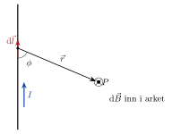
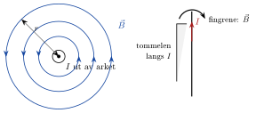

<!-- video: kommer (videoer/ingeniorfysikk/16-01-biot-savarts-lov) -->
{fig-alt="Video kommer"}

<!-- tillegg: Claude -->
Så langt har vi sett hva et magnetfelt gjør med ladninger og strømmer. Nå snur vi spørsmålet: Hvor kommer feltet fra? Svaret er at **strøm lager magnetfelt**. Biot–Savarts lov sier hvor mye felt hver liten bit av en leder bidrar med. Den spiller samme rolle for magnetfeltet som Coulombs lov for det elektriske feltet.

## Loven

{.tikz-fig style="width:380px"}

::: {.callout-important title="Biot–Savarts lov"}
<!-- tillegg: Claude -->
$$
\mathrm{d}\vec B = \frac{\mu_0}{4\pi}\,\frac{I\,\mathrm{d}\vec l\times\hat r}{r^2}, \qquad \mathrm{d}B = \frac{\mu_0}{4\pi}\,\frac{I\,\mathrm{d}l\,\sin\phi}{r^2}
$$
der $\vec r$ går fra lederbiten til punktet, og $\phi$ er vinkelen mellom $\mathrm{d}\vec l$ og $\vec r$. Konstanten $\mu_0 = 4\pi\cdot10^{-7}\ \mathrm{T\,m/A}$ er **permeabiliteten i vakuum**.
:::

<!-- tillegg: Claude -->
Legg merke til likhetene med Coulombs lov: Feltet avtar som $1/r^2$, og det er proporsjonalt med kilden ($I\,\mathrm{d}l$ i stedet for $q$). Forskjellen er kryssproduktet: Det magnetiske feltet peker ikke bort fra kilden, men **rundt** den. Langs selve lederen ($\phi = 0$) gir en bit ikke noe bidrag i det hele tatt.

For å finne det samlede feltet summerer (integrerer) vi bidragene fra alle bitene: $\vec B = \int\mathrm{d}\vec B$.

## Felt fra en lang, rett leder

<!-- tillegg: Claude -->
For en uendelig lang, rett leder peker alle bidragene i samme retning i punktet $P$. Integralet kan regnes ut (se oppgaven nederst), og svaret blir

::: {.callout-important title="Felt fra en lang, rett leder"}
<!-- tillegg: Claude -->
$$
B = \frac{\mu_0 I}{2\pi r}
$$
der $r$ er den vinkelrette avstanden til lederen. Feltlinjene er sirkler rundt lederen.
:::

{.tikz-fig style="width:520px"}

<!-- tillegg: Claude -->
Feltet avtar som $1/r$ – langsommere enn fra en punktladning, fordi lederen er lang. Retningen finner vi med **høyrehåndsregelen**: Grip lederen med høyre hånd, med tommelen i strømretningen. Fingrene bøyer seg i feltets retning.

::: {.eksempel}
<!-- tillegg: Claude -->
**Eksempel: Felt nær en ledning.** En lang ledning fører $10\ \mathrm{A}$. Hvor sterkt er feltet $5.0\ \mathrm{cm}$ fra ledningen? Sammenlign med jordas magnetfelt, ca. $5\cdot10^{-5}\ \mathrm{T}$.

::: {.losning}
$$
B = \frac{\mu_0 I}{2\pi r} = \frac{4\pi\cdot10^{-7}\cdot10}{2\pi\cdot0.050}\ \mathrm{T} = \underline{\underline{4.0\cdot10^{-5}\ \mathrm{T}}}
$$
Omtrent like sterkt som jordas felt. Derfor kan et kompass nær en strømførende ledning slå ut – slik Ørsted oppdaget i 1820.
:::
:::

## Felt i sentrum av en strømsløyfe

<!-- tillegg: Claude -->
En sirkulær sløyfe med radius $R$ er det enkleste eksempelet å regne ut selv. I sentrum er avstanden til hver bit lik $R$, og $\mathrm{d}\vec l$ står alltid vinkelrett på $\vec r$ ($\sin\phi = 1$). Alle bidragene peker samme vei, langs aksen. Da blir integralet bare en sum av lengder:
$$
B = \frac{\mu_0}{4\pi}\frac{I}{R^2}\oint\mathrm{d}l = \frac{\mu_0}{4\pi}\frac{I}{R^2}\cdot2\pi R
$$

::: {.callout-important title="Felt i sentrum av en sirkulær sløyfe"}
<!-- tillegg: Claude -->
$$
B = \frac{\mu_0 I}{2R} \qquad\text{og med $N$ vindinger:}\qquad B = \frac{\mu_0 N I}{2R}
$$
:::

<!-- tillegg: Claude -->
Retningen gir høyrehåndsregelen igjen: Bøy fingrene langs strømmen i sløyfa, så peker tommelen langs feltet gjennom sentrum. En strømsløyfe oppfører seg som en liten stavmagnet med nordpolen på den siden tommelen peker.

::: {.eksempel}
<!-- tillegg: Claude -->
**Eksempel: Spole.** En flat spole med radius $5.0\ \mathrm{cm}$ fører $2.0\ \mathrm{A}$. Finn feltet i sentrum for én vinding og for $50$ vindinger.

::: {.losning}
$$
B_1 = \frac{\mu_0 I}{2R} = \frac{4\pi\cdot10^{-7}\cdot2.0}{2\cdot0.050}\ \mathrm{T} = \underline{\underline{2.5\cdot10^{-5}\ \mathrm{T}}}, \qquad B_{50} = 50B_1 = \underline{\underline{1.3\cdot10^{-3}\ \mathrm{T}}}
$$
:::
:::

## Regn det ut selv

<!-- tillegg: Claude -->
Biot–Savarts lov kan integreres numerisk for en hvilken som helst form på lederen. Koden under deler en rett leder med lengde $2L$ i små biter og summerer bidragene. Når lederen blir lang, nærmer svaret seg $\mu_0I/(2\pi r)$.

```{.python .kjor}
import numpy as np
mu0 = 4*np.pi*1e-7
I, r = 10.0, 0.05            # strøm (A) og avstand (m)

for L in [0.05, 0.2, 1.0, 10.0]:
    y = np.linspace(-L, L, 200001)      # posisjoner langs lederen
    dl = y[1] - y[0]
    rr = np.sqrt(r**2 + y**2)
    sinphi = r/rr                       # vinkelen mellom dl og r
    B = mu0/(4*np.pi)*np.sum(I*dl*sinphi/rr**2)
    print(f"lengde {2*L:6.2f} m:  B = {B:.3e} T")

print(f"uendelig lang:     B = {mu0*I/(2*np.pi*r):.3e} T")
```

:::: {.oppgaver}

::: {.oppgave tittel="Kraftlinje"}
<!-- tillegg: Claude -->
En kraftlinje fører $500\ \mathrm{A}$. Hvor sterkt er magnetfeltet på bakken $20\ \mathrm{m}$ under linja? Sammenlign med jordas felt.

::: {.losning}
$$
B = \frac{\mu_0 I}{2\pi r} = \frac{4\pi\cdot10^{-7}\cdot500}{2\pi\cdot20}\ \mathrm{T} = \underline{\underline{5.0\cdot10^{-6}\ \mathrm{T}}}
$$
Omtrent en tidel av jordas felt.
:::
:::

::: {.oppgave tittel="Hvor langt unna?"}
<!-- tillegg: Claude -->
Hvor langt fra en ledning med $10\ \mathrm{A}$ har feltet sunket til $1.0\ \mathrm{\mu T}$?

::: {.losning}
$$
r = \frac{\mu_0 I}{2\pi B} = \frac{4\pi\cdot10^{-7}\cdot10}{2\pi\cdot1.0\cdot10^{-6}}\ \mathrm{m} = \underline{\underline{2.0\ \mathrm{m}}}
$$
:::
:::

::: {.oppgave tittel="To ledere med motsatt strøm" niva="Middels"}
<!-- tillegg: Claude -->
To lange, parallelle ledere står $20\ \mathrm{cm}$ fra hverandre og fører $10\ \mathrm{A}$ hver, i motsatt retning. Finn feltet midt mellom dem.

::: {.losning}
Hver leder gir $B_1 = \dfrac{\mu_0 I}{2\pi\cdot0.10} = 2.0\cdot10^{-5}\ \mathrm{T}$. Med høyrehåndsregelen ser vi at feltene fra to motsatte strømmer peker **samme vei** midt mellom lederne. De legges sammen:
$$
B = 2B_1 = \underline{\underline{4.0\cdot10^{-5}\ \mathrm{T}}}
$$
(Med strøm i samme retning ville feltene oppheve hverandre, og $B = 0$ midt mellom.)
:::
:::

::: {.oppgave tittel="Utled feltet fra en rett leder" niva="Utfordrende"}
<!-- tillegg: Claude -->
Legg lederen langs $y$-aksen og punktet $P$ i avstanden $r$ på $x$-aksen. Vis med Biot–Savarts lov at en uendelig lang leder gir $B = \mu_0I/(2\pi r)$. Tips: $\int_{-\infty}^{\infty}\dfrac{\mathrm{d}y}{(r^2+y^2)^{3/2}} = \dfrac{2}{r^2}$.

::: {.losning}
For biten ved $y$ er avstanden $\sqrt{r^2+y^2}$ og $\sin\phi = r/\sqrt{r^2+y^2}$. Alle bidragene peker samme vei, så
$$
B = \frac{\mu_0 I}{4\pi}\int_{-\infty}^{\infty}\frac{\sin\phi\,\mathrm{d}y}{r^2+y^2} = \frac{\mu_0 I}{4\pi}\int_{-\infty}^{\infty}\frac{r\,\mathrm{d}y}{(r^2+y^2)^{3/2}} = \frac{\mu_0 I}{4\pi}\cdot r\cdot\frac{2}{r^2} = \underline{\underline{\frac{\mu_0 I}{2\pi r}}}
$$
:::
:::

::::
