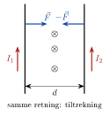

<!-- video: kommer (videoer/ingeniorfysikk/16-02-kraft-mellom-ledere) -->
{fig-alt="Video kommer"}

<!-- tillegg: Claude -->
En strøm lager et magnetfelt, og en strøm i et magnetfelt får en kraft. Setter vi to ledere ved siden av hverandre, kjenner derfor hver av dem feltet fra den andre. Resultatet er overraskende enkelt: **Strømmer i samme retning tiltrekker hverandre, strømmer i motsatt retning frastøter hverandre.**

## Kraften per lengde

{.tikz-fig style="width:300px"}

<!-- tillegg: Claude -->
Leder 1 lager feltet $B_1 = \mu_0I_1/(2\pi d)$ der leder 2 er. Feltet står vinkelrett på leder 2, så kraften på en lengde $L$ av leder 2 er $F = I_2LB_1$:

::: {.callout-important title="Kraft mellom to parallelle ledere"}
<!-- tillegg: Claude -->
$$
\frac{F}{L} = \frac{\mu_0 I_1 I_2}{2\pi d}
$$
Samme retning: tiltrekning. Motsatt retning: frastøtning. Kraften på leder 1 er like stor og motsatt rettet (Newtons tredje lov).
:::

<!-- tillegg: Claude -->
Sjekk retningen med figuren: Strømmen i den venstre lederen går oppover. Til høyre for den peker feltet inn i arket. Den høyre lederen har også strøm oppover, og $\vec L\times\vec B$ = opp × inn = mot venstre. Den høyre lederen trekkes altså mot den venstre.

::: {.callout-note title="Ampere-definisjonen" .graa}
<!-- tillegg: Claude -->
Fram til 2019 var ampere **definert** ved denne kraften: $1\ \mathrm{A}$ var strømmen som gir kraften $2\cdot10^{-7}\ \mathrm{N}$ per meter mellom to lange ledere $1\ \mathrm{m}$ fra hverandre. Derfor var $\mu_0$ eksakt $4\pi\cdot10^{-7}\ \mathrm{T\,m/A}$. I dag er ampere definert fra elementærladningen $\mathrm{e}$, og $\mu_0$ er en målt størrelse – men lik $4\pi\cdot10^{-7}$ med ti gjeldende siffer.
:::

::: {.eksempel}
<!-- tillegg: Claude -->
**Eksempel: To ledere.** To lange, parallelle ledere står $1.0\ \mathrm{cm}$ fra hverandre og fører $10\ \mathrm{A}$ hver, i samme retning. Finn kraften per meter.

::: {.losning}
$$
\frac{F}{L} = \frac{\mu_0 I_1 I_2}{2\pi d} = \frac{4\pi\cdot10^{-7}\cdot10\cdot10}{2\pi\cdot0.010}\ \mathrm{N/m} = \underline{\underline{2.0\cdot10^{-3}\ \mathrm{N/m}}}
$$
Tiltrekning, siden strømmene går samme vei.
:::
:::

::: {.eksempel}
<!-- tillegg: Claude -->
**Eksempel: Kurset i veggen.** I en kabel går strømmen fram i den ene lederen og tilbake i den andre. Lederne ligger $3.0\ \mathrm{mm}$ fra hverandre, og strømmen er $10\ \mathrm{A}$. Blir lederne trukket mot hverandre eller presset fra hverandre? Hvor stor er kraften per meter?

::: {.losning}
Strømmene går motsatt vei, så lederne **frastøter** hverandre:
$$
\frac{F}{L} = \frac{4\pi\cdot10^{-7}\cdot10\cdot10}{2\pi\cdot0.0030}\ \mathrm{N/m} = \underline{\underline{6.7\cdot10^{-3}\ \mathrm{N/m}}}
$$
Lite i vanlig drift. Ved en kortslutning kan strømmen bli flere tusen ampere, og kraften vokser med kvadratet av strømmen – da kan kabler og samleskinner rive seg løs.
:::
:::

:::: {.oppgaver}

::: {.oppgave tittel="Dobbel strøm"}
<!-- tillegg: Claude -->
Hva skjer med kraften mellom to ledere hvis strømmen i begge dobles? Hva om avstanden i tillegg dobles?

::: {.losning}
$F/L \propto I_1I_2/d$. Dobbel strøm i begge gir **4 ganger** så stor kraft. Dobler vi også avstanden, blir kraften **2 ganger** den opprinnelige.
:::
:::

::: {.oppgave tittel="Finn strømmen"}
<!-- tillegg: Claude -->
To parallelle ledere $5.0\ \mathrm{cm}$ fra hverandre fører like store strømmer. Kraften mellom dem er $4.0\cdot10^{-4}\ \mathrm{N}$ per meter. Hvor stor er strømmen?

::: {.losning}
$$
I^2 = \frac{2\pi d\,(F/L)}{\mu_0} = \frac{2\pi\cdot0.050\cdot4.0\cdot10^{-4}}{4\pi\cdot10^{-7}}\ \mathrm{A^2} = 100\ \mathrm{A^2}, \qquad I = \underline{\underline{10\ \mathrm{A}}}
$$
:::
:::

::: {.oppgave tittel="Svevende leder" niva="Middels"}
<!-- tillegg: Claude -->
En lang, vannrett leder ligger fast og fører $80\ \mathrm{A}$. Rett over den, parallelt, henger en tynn leder med masse $1.0\ \mathrm{g}$ per meter og strømmen $20\ \mathrm{A}$. Hvor høyt over den faste lederen kan den tynne sveve? Hvilken vei må strømmen i den gå?

::: {.losning}
Den magnetiske kraften må peke opp, altså frastøtning: strømmene må gå **motsatt vei**. Kraften må bære tyngden:
$$
\frac{\mu_0 I_1I_2}{2\pi d} = \frac mL\,\mathrm{g} \quad\Rightarrow\quad d = \frac{\mu_0 I_1I_2}{2\pi(m/L)\mathrm{g}} = \frac{4\pi\cdot10^{-7}\cdot80\cdot20}{2\pi\cdot1.0\cdot10^{-3}\cdot9.81}\ \mathrm{m} = \underline{\underline{3.3\ \mathrm{cm}}}
$$
(Likevekten er stabil loddrett: Kommer lederen nærmere, blir frastøtningen større og skyver den opp igjen.)
:::
:::

::: {.oppgave tittel="Tre ledere" niva="Utfordrende"}
<!-- tillegg: Claude -->
Tre lange, parallelle ledere ligger i samme plan med $10\ \mathrm{cm}$ mellom naboene. Alle fører $20\ \mathrm{A}$ i samme retning. Finn kraften per meter på den midterste og på en av de ytterste.

::: {.losning}
Den midterste trekkes like mye mot hver side: **kraften er null**.

Den ytterste trekkes mot de to andre, som ligger $0.10\ \mathrm{m}$ og $0.20\ \mathrm{m}$ unna:
$$
\frac FL = \frac{\mu_0 I^2}{2\pi}\left(\frac{1}{0.10}+\frac{1}{0.20}\right) = 2\cdot10^{-7}\cdot400\cdot15\ \mathrm{N/m} = \underline{\underline{1.2\cdot10^{-3}\ \mathrm{N/m}}}
$$
rettet innover, mot de andre lederne.
:::
:::

::::
