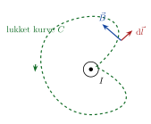
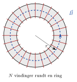

<!-- video: kommer (videoer/ingeniorfysikk/16-03-amperes-lov) -->
{fig-alt="Video kommer"}

<!-- tillegg: Claude -->
Biot–Savarts lov virker alltid, men integralene blir fort tunge. For det elektriske feltet hadde vi en snarvei når ladningen var symmetrisk fordelt: Gauss' lov. Magnetfeltet har en tilsvarende snarvei: **Ampères lov**. Den bruker en lukket *kurve* i stedet for en lukket flate.

## Loven

{.tikz-fig style="width:340px"}

::: {.callout-important title="Ampères lov"}
<!-- tillegg: Claude -->
$$
\oint_C \vec B\cdot\mathrm{d}\vec l = \mu_0 I_\text{inn}
$$
Linjeintegralet av $\vec B$ rundt en lukket kurve er lik $\mu_0$ ganger den samlede strømmen som går **gjennom** kurven.
:::

<!-- tillegg: Claude -->
Noen ting å merke seg:

::: {.kort}
- **Formen på kurven spiller ingen rolle.** Bare strømmen som går gjennom den, teller. Strømmer utenfor kurven bidrar til $\vec B$ langs kurven, men ikke til integralet.
- **Fortegn:** Bøy fingrene på høyre hånd i den retningen du går rundt kurven. Strøm i tommelens retning teller positivt, motsatt negativt.
- **Loven gjelder alltid, men hjelper bare ved symmetri.** Vi velger en kurve der $B$ er konstant og parallell med $\mathrm{d}\vec l$ (eller vinkelrett, så bidraget blir null). Da blir integralet $B$ ganger en lengde.
:::

::: {.callout-note title="Sammenlignet med Gauss' lov" .graa}
<!-- tillegg: Claude -->
| | Gauss' lov | Ampères lov |
|---|---|---|
| Hva vi integrerer | $\vec E$ over en lukket **flate** | $\vec B$ langs en lukket **kurve** |
| Kilde | ladning inni, $Q_\text{inn}/\varepsilon_0$ | strøm gjennom, $\mu_0 I_\text{inn}$ |
| Lur symmetri | kule, sylinder, plan | sylinder (leder), solenoide, toroide |
:::

## Felt utenfor en rett leder

<!-- tillegg: Claude -->
Feltlinjene rundt en lang, rett leder er sirkler. Vi velger derfor en sirkel med radius $r$ som kurve. Langs den er $B$ like stor overalt og parallell med $\mathrm{d}\vec l$:
$$
\oint\vec B\cdot\mathrm{d}\vec l = B\cdot2\pi r = \mu_0 I \quad\Rightarrow\quad B = \frac{\mu_0 I}{2\pi r}
$$
Samme svar som fra Biot–Savarts lov – på én linje i stedet for et integral.

## Felt inni en leder

<!-- tillegg: Claude -->
En tykk leder med radius $R$ fører strømmen $I$, jevnt fordelt over tverrsnittet. Inni lederen ($r < R$) går bare en del av strømmen gjennom sirkelen vår, nemlig andelen av arealet:
$$
I_\text{inn} = I\,\frac{\pi r^2}{\pi R^2} \quad\Rightarrow\quad B\cdot2\pi r = \mu_0 I\frac{r^2}{R^2} \quad\Rightarrow\quad B = \frac{\mu_0 I\,r}{2\pi R^2}
$$
Feltet vokser lineært fra null i sentrum til $\mu_0I/(2\pi R)$ på overflaten, og avtar så som $1/r$ utenfor.

```{.python .kjor}
import numpy as np
import matplotlib.pyplot as plt
mu0 = 4*np.pi*1e-7
I, R = 10.0, 0.002                       # 10 A i en leder med radius 2 mm
r = np.linspace(0, 5*R, 500)
B = np.where(r < R, mu0*I*r/(2*np.pi*R**2), mu0*I/(2*np.pi*np.maximum(r, 1e-12)))
plt.plot(r*1000, B*1000)
plt.axvline(R*1000, ls="--", c="gray")
plt.xlabel("avstand fra sentrum $r$ (mm)"); plt.ylabel("$B$ (mT)")
plt.title("Felt inni og utenfor en tykk leder")
plt.show()
```

::: {.eksempel}
<!-- tillegg: Claude -->
**Eksempel: Inni en ledning.** En kobberledning med radius $2.0\ \mathrm{mm}$ fører $10\ \mathrm{A}$. Finn feltet $1.0\ \mathrm{mm}$ fra sentrum og på overflaten.

::: {.losning}
$$
B(1.0\ \mathrm{mm}) = \frac{\mu_0 I r}{2\pi R^2} = \frac{4\pi\cdot10^{-7}\cdot10\cdot0.0010}{2\pi\cdot0.0020^2}\ \mathrm{T} = \underline{\underline{5.0\cdot10^{-4}\ \mathrm{T}}}
$$
På overflaten er $r = R$, og feltet er dobbelt så stort: $\underline{\underline{1.0\cdot10^{-3}\ \mathrm{T}}}$.
:::
:::

## Koaksialkabelen

<!-- tillegg: Claude -->
En koaksialkabel har en leder i midten og en sylinderformet skjerm rundt. Strømmen går fram i midtlederen og tilbake i skjermen. En sirkel **utenfor** kabelen omslutter begge strømmene: $I_\text{inn} = I - I = 0$, så $B = 0$ utenfor. Mellom lederne er $B = \mu_0I/(2\pi r)$. Feltet holdes altså inne i kabelen, og kabelen verken forstyrrer eller blir forstyrret av omgivelsene. Derfor brukes den til antenner og signaler.

:::: {.oppgaver}

::: {.oppgave tittel="Strøm gjennom kurven"}
<!-- tillegg: Claude -->
Tre ledere går gjennom en lukket kurve: $5\ \mathrm{A}$ og $3\ \mathrm{A}$ i positiv retning og $2\ \mathrm{A}$ i negativ retning. En fjerde leder med $10\ \mathrm{A}$ går utenfor kurven. Hva er $\oint\vec B\cdot\mathrm{d}\vec l$?

::: {.losning}
Bare strømmen gjennom kurven teller: $I_\text{inn} = 5+3-2 = 6\ \mathrm{A}$.
$$
\oint\vec B\cdot\mathrm{d}\vec l = \mu_0\cdot6\ \mathrm{A} = \underline{\underline{7.5\cdot10^{-6}\ \mathrm{T\,m}}}
$$
:::
:::

::: {.oppgave tittel="Hvor er feltet størst?"}
<!-- tillegg: Claude -->
En tykk leder med radius $R$ fører strømmen $I$ jevnt fordelt. Hvor er feltet sterkest? Ved hvilke to avstander er feltet halvparten av det største?

::: {.losning}
Størst på **overflaten**, $B_\text{maks} = \mu_0I/(2\pi R)$. Inni vokser $B$ lineært, så halvparten er ved $r = R/2$. Utenfor avtar $B$ som $1/r$, så halvparten er ved $r = 2R$.
:::
:::

::: {.oppgave tittel="Toroide" niva="Middels"}
<!-- tillegg: Claude -->
{.tikz-fig style="width:220px"}

En toroide er en spole viklet rundt en ring. Den har $N = 1000$ vindinger og strømmen $1.0\ \mathrm{A}$. Bruk Ampères lov med en sirkel med radius $r$ inni ringen og vis at $B = \mu_0NI/(2\pi r)$. Finn feltet ved $r = 10\ \mathrm{cm}$. Hva er feltet utenfor ringen og i hullet?

::: {.losning}
En sirkel inni ringen omslutter $N$ ledere med strømmen $I$, alle samme vei. Av symmetri er $B$ konstant langs sirkelen:
$$
B\cdot2\pi r = \mu_0 NI \quad\Rightarrow\quad B = \frac{\mu_0NI}{2\pi r} = \frac{4\pi\cdot10^{-7}\cdot1000\cdot1.0}{2\pi\cdot0.10}\ \mathrm{T} = \underline{\underline{2.0\cdot10^{-3}\ \mathrm{T}}}
$$
En sirkel i hullet omslutter ingen strøm: $B = 0$. En sirkel utenfor omslutter $N$ strømmer opp og $N$ strømmer ned: $I_\text{inn} = 0$ og $B = 0$. Hele feltet er stengt inne i ringen.
:::
:::

::: {.oppgave tittel="Hul leder" niva="Utfordrende"}
<!-- tillegg: Claude -->
Et tykt rør har indre radius $a$ og ytre radius $b$, og fører strømmen $I$ jevnt fordelt i veggen. Finn $B(r)$ i de tre områdene $r<a$, $a<r<b$ og $r>b$.

::: {.losning}
- $r < a$: Ingen strøm gjennom sirkelen, $\underline{\underline{B = 0}}$.
- $a < r < b$: Andelen av veggarealet innenfor $r$ er $\dfrac{r^2-a^2}{b^2-a^2}$, så
$$
\underline{\underline{B = \frac{\mu_0 I}{2\pi r}\cdot\frac{r^2-a^2}{b^2-a^2}}}
$$
- $r > b$: Hele strømmen, $\underline{\underline{B = \dfrac{\mu_0I}{2\pi r}}}$.

Sjekk: Uttrykkene henger sammen ved $r = a$ (begge null) og $r = b$.
:::
:::

::::
