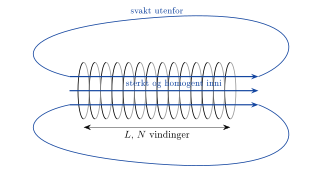

<!-- video: kommer (videoer/ingeniorfysikk/16-04-solenoide) -->
{fig-alt="Video kommer"}

<!-- tillegg: Claude -->
En **solenoide** er en lang spole: en ledning viklet tett i mange vindinger rundt en sylinder. Feltene fra alle vindingene legges sammen. Inni blir feltet sterkt og nesten homogent, utenfor svakt. Solenoiden er for magnetfeltet det platekondensatoren er for det elektriske feltet: den enkleste måten å lage et jevnt felt på.

## Feltet i en solenoide

{.tikz-fig style="width:520px"}

<!-- tillegg: Claude -->
Vi bruker Ampères lov med et rektangel: én side med lengde $\ell$ inni solenoiden (langs feltet), én side utenfor (der feltet er nesten null), og to sider på tvers (vinkelrett på feltet). Bare siden inni bidrar til integralet, med $B\ell$. Gjennom rektangelet går $n\ell$ vindinger, der $n = N/L$ er antall vindinger per lengde:
$$
B\ell = \mu_0\,n\ell\,I
$$

::: {.callout-important title="Felt inni en lang solenoide"}
<!-- tillegg: Claude -->
$$
B = \mu_0 n I = \mu_0\frac{N}{L}I
$$
der $n = N/L$ er antall vindinger per meter. Feltet er like stort overalt inni (bortsett fra nær endene), og peker langs aksen.
:::

<!-- tillegg: Claude -->
Legg merke til at feltet **ikke** avhenger av radiusen til solenoiden – bare av hvor tett den er viklet og hvor stor strømmen er. Retningen gir høyrehåndsregelen: Bøy fingrene langs strømmen i vindingene, så peker tommelen langs feltet inni. Den enden tommelen peker mot, er solenoidens **nordpol**.

Ved endene sprer feltlinjene seg ut, og feltet på selve endeflaten er omtrent halvparten av feltet i midten.

::: {.eksempel}
<!-- tillegg: Claude -->
**Eksempel: Laboratoriesolenoide.** En solenoide er $25\ \mathrm{cm}$ lang og har $500$ vindinger. Strømmen er $2.0\ \mathrm{A}$. Finn feltet inni.

::: {.losning}
$$
B = \mu_0\frac NL I = 4\pi\cdot10^{-7}\cdot\frac{500}{0.25}\cdot2.0\ \mathrm{T} = \underline{\underline{5.0\cdot10^{-3}\ \mathrm{T}}}
$$
Omtrent hundre ganger jordas felt.
:::
:::

::: {.eksempel}
<!-- tillegg: Claude -->
**Eksempel: MR-maskin.** En MR-maskin har feltet $1.5\ \mathrm{T}$ inni en stor solenoide av superledende tråd. Strømmen er $500\ \mathrm{A}$. Hvor mange vindinger per meter trengs?

::: {.losning}
$$
n = \frac{B}{\mu_0 I} = \frac{1.5}{4\pi\cdot10^{-7}\cdot500}\ \mathrm{m^{-1}} = \underline{\underline{2.4\cdot10^{3}\ \mathrm{m^{-1}}}}
$$
Over to tusen vindinger per meter, med en strøm som vanlig kobbertråd ikke ville tålt over tid. Derfor brukes superledere, kjølt med flytende helium.
:::
:::

## Jernkjerne og elektromagneter

<!-- tillegg: Claude -->
Fyller vi solenoiden med jern, blir feltet mange hundre ganger sterkere. Jernet består av små magnetiske områder som retter seg inn etter feltet fra strømmen og forsterker det. Vi skriver $B = \mu n I$, der $\mu = \mu_r\mu_0$ og den **relative permeabiliteten** $\mu_r$ kan være flere tusen for jern. Slik lages elektromagneter i kraner, releer, høyttalere og transformatorer. Slår vi av strømmen, forsvinner (det meste av) feltet.

## Kraften fra en solenoide på seg selv

::: {.callout-note title="Hvorfor solenoiden presses sammen" .graa}
<!-- tillegg: Claude -->
Nabovindingene i en solenoide fører strøm i samme retning. Fra *kraft mellom ledere* vet vi at de da tiltrekker hverandre. En solenoide med stor strøm prøver derfor å trekke seg sammen på langs. I kraftige magneter må vindingene støttes for å tåle disse kreftene.
:::

:::: {.oppgaver}

::: {.oppgave tittel="Hvor stor strøm?"}
<!-- tillegg: Claude -->
En solenoide har $800$ vindinger på $40\ \mathrm{cm}$. Hvor stor strøm trengs for feltet $10\ \mathrm{mT}$?

::: {.losning}
$$
I = \frac{B}{\mu_0 n} = \frac{0.010}{4\pi\cdot10^{-7}\cdot2000}\ \mathrm{A} = \underline{\underline{4.0\ \mathrm{A}}}
$$
:::
:::

::: {.oppgave tittel="Strekk spolen"}
<!-- tillegg: Claude -->
En solenoide strekkes til dobbel lengde med det samme antallet vindinger og den samme strømmen. Hva skjer med feltet inni? Hva om du i stedet vikler dobbelt så mange vindinger på samme lengde?

::: {.losning}
$B = \mu_0 (N/L) I$. Dobbel lengde gir **halvt** så sterkt felt. Dobbelt så mange vindinger på samme lengde gir **dobbelt** så sterkt felt. Radiusen spiller ingen rolle.
:::
:::

::: {.oppgave tittel="Elektron i solenoiden" niva="Middels"}
<!-- tillegg: Claude -->
Et elektron beveger seg med farten $2.0\cdot10^{6}\ \mathrm{m/s}$ vinkelrett på aksen inni solenoiden fra eksempelet ($B = 5.0\ \mathrm{mT}$). Hvilken radius får sirkelbanen? Hvor stor radius må solenoiden minst ha for at elektronet ikke skal treffe veggen, hvis det starter på aksen?

::: {.losning}
$$
r = \frac{m v}{\mathrm{e}B} = \frac{9.11\cdot10^{-31}\cdot2.0\cdot10^{6}}{1.60\cdot10^{-19}\cdot5.0\cdot10^{-3}}\ \mathrm{m} = \underline{\underline{2.3\ \mathrm{mm}}}
$$
Starter elektronet på aksen, kommer det lengst $2r = 4.6\ \mathrm{mm}$ fra aksen. Solenoiden må ha radius på minst $\underline{\underline{4.6\ \mathrm{mm}}}$.
:::
:::

::: {.oppgave tittel="Solenoide av ledning" niva="Utfordrende"}
<!-- tillegg: Claude -->
Du har $10\ \mathrm{m}$ kobbertråd med diameter $1.0\ \mathrm{mm}$ og vil vikle en solenoide i ett lag, tett i tett, på et rør med diameter $2.0\ \mathrm{cm}$. Tråden tåler $3.0\ \mathrm{A}$. Hvor lang blir solenoiden, og hvor sterkt felt kan du lage?

::: {.losning}
Hver vinding bruker $\pi\cdot0.020\ \mathrm{m} = 0.0628\ \mathrm{m}$ tråd, så $N = 10/0.0628 = 159$ vindinger. Tett i tett tar hver vinding $1.0\ \mathrm{mm}$, så lengden blir $\underline{\underline{16\ \mathrm{cm}}}$. Tettheten er $n = 1000\ \mathrm{m^{-1}}$ uansett:
$$
B = \mu_0 n I = 4\pi\cdot10^{-7}\cdot1000\cdot3.0\ \mathrm{T} = \underline{\underline{3.8\ \mathrm{mT}}}
$$
Merk: Feltet avhenger bare av trådtykkelsen og strømmen, ikke av hvor mye tråd du har. Vil du ha sterkere felt, må du vikle flere lag.
:::
:::

::::
