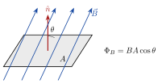
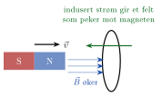

<!-- video: kommer (videoer/ingeniorfysikk/17-01-faraday-og-lenz) -->
{fig-alt="Video kommer"}

<!-- tillegg: Claude -->
En strøm lager et magnetfelt. Kan et magnetfelt lage en strøm? Ja – men bare når det **endrer seg**. Det var Michael Faradays store oppdagelse i 1831. Den ligger bak generatorer, transformatorer, induksjonstopper, trådløs lading og elektriske gitarer.

## Magnetisk fluks

{.tikz-fig style="width:440px"}

::: {.callout-note title="Definisjon: magnetisk fluks"}
<!-- tillegg: Claude -->
$$
\Phi_B = \int\vec B\cdot\mathrm{d}\vec A, \qquad \Phi_B = BA\cos\theta \text{ for homogent felt og plan flate}
$$
der $\theta$ er vinkelen mellom feltet og normalen til flaten. Enheten er **weber**: $1\ \mathrm{Wb} = 1\ \mathrm{T\,m^2}$.
:::

<!-- tillegg: Claude -->
Fluksen kan endre seg på tre måter: Feltet blir sterkere eller svakere, arealet endrer seg, eller vinkelen endrer seg (sløyfa dreies).

## Faradays lov

::: {.callout-important title="Faradays induksjonslov"}
<!-- tillegg: Claude -->
$$
\mathcal E = -N\frac{\mathrm{d}\Phi_B}{\mathrm{d}t}
$$
Når fluksen gjennom en spole med $N$ vindinger endrer seg, induseres en elektromotorisk spenning $\mathcal E$ i spolen. Den er proporsjonal med **hvor fort** fluksen endrer seg.
:::

<!-- tillegg: Claude -->
Det er endringen som teller, ikke hvor sterkt feltet er. En sterk magnet som ligger i ro i en spole, gir ingen spenning. En svak magnet som beveges raskt, gir en merkbar spenning.

Er spolen en del av en lukket krets med resistansen $R$, går det en **indusert strøm** $I = \mathcal E/R$.

::: {.eksempel}
<!-- tillegg: Claude -->
**Eksempel: Felt som slås på.** En spole med $200$ vindinger og areal $20\ \mathrm{cm^2}$ står vinkelrett på et magnetfelt. Feltet øker jevnt fra $0$ til $0.50\ \mathrm{T}$ på $0.10\ \mathrm{s}$. Finn fluksen til slutt og den induserte spenningen.

::: {.losning}
$$
\Phi_B = BA = 0.50\cdot20\cdot10^{-4}\ \mathrm{Wb} = \underline{\underline{1.0\cdot10^{-3}\ \mathrm{Wb}}}
$$
$$
|\mathcal E| = N\frac{\Delta\Phi_B}{\Delta t} = 200\cdot\frac{1.0\cdot10^{-3}}{0.10}\ \mathrm{V} = \underline{\underline{2.0\ \mathrm{V}}}
$$
:::
:::

## Lenz' lov: retningen

{.tikz-fig style="width:380px"}

::: {.callout-important title="Lenz' lov"}
<!-- tillegg: Claude -->
Den induserte strømmen går slik at **dens eget magnetfelt motvirker endringen** i fluksen. Det er minustegnet i Faradays lov.
:::

<!-- tillegg: Claude -->
Slik bruker du den:

::: {.steg}
1. Finn retningen på feltet gjennom sløyfa.
2. Øker eller minker fluksen?
3. Øker den, må det induserte feltet peke **motsatt** vei. Minker den, peker det induserte feltet **samme** vei (det prøver å holde fluksen oppe).
4. Finn strømretningen med høyrehåndsregelen for en sløyfe: tommelen langs det induserte feltet, fingrene langs strømmen.
:::

<!-- tillegg: Claude -->
I figuren nærmer nordpolen seg, og fluksen mot høyre øker. Det induserte feltet peker mot venstre – sløyfa blir en magnet med nordpolen mot magneten og **frastøter** den. Du må gjøre et arbeid for å skyve magneten inn, og det arbeidet blir til elektrisk energi. Lenz' lov er altså energibevaring: Gikk strømmen motsatt vei, ville magneten blitt trukket inn av seg selv og produsert energi fra ingenting.

::: {.callout-note title="Forsøk: magnet i kobberrør" .graa}
<!-- tillegg: Claude -->
Slipper du en sterk magnet ned i et kobberrør, faller den påfallende sakte. Kobber er ikke magnetisk, men den fallende magneten induserer strømmer i røret som lager felt som bremser den. Slipper du en like tung bit som ikke er magnetisk, faller den rett gjennom.
:::

:::: {.oppgaver}

::: {.oppgave tittel="Dreid sløyfe"}
<!-- tillegg: Claude -->
En kvadratisk sløyfe med sider $10\ \mathrm{cm}$ står vinkelrett på et felt på $0.30\ \mathrm{T}$. Den dreies $90^\circ$ på $0.050\ \mathrm{s}$, så den til slutt ligger langs feltet. Finn gjennomsnittlig indusert spenning.

::: {.losning}
Fluksen går fra $BA = 0.30\cdot0.010\ \mathrm{Wb} = 3.0\cdot10^{-3}\ \mathrm{Wb}$ til $0$:
$$
|\mathcal E| = \frac{\Delta\Phi_B}{\Delta t} = \frac{3.0\cdot10^{-3}}{0.050}\ \mathrm{V} = \underline{\underline{0.060\ \mathrm{V}}}
$$
:::
:::

::: {.oppgave tittel="Retning med Lenz"}
<!-- tillegg: Claude -->
En sløyfe ligger i arkets plan i et felt som peker ut av arket. Feltet **avtar**. Går den induserte strømmen med eller mot klokka?

::: {.losning}
Fluksen ut av arket minker. Det induserte feltet må derfor peke **ut av arket** for å holde den oppe. Tommelen ut av arket gir strøm **mot klokka**.
:::
:::

::: {.oppgave tittel="Ladning gjennom kretsen" niva="Middels"}
<!-- tillegg: Claude -->
En spole med $50$ vindinger og areal $0.010\ \mathrm{m^2}$ står vinkelrett på et felt på $0.40\ \mathrm{T}$. Spolen er koblet til en krets med samlet resistans $2.0\ \Omega$. Spolen trekkes raskt ut av feltet. Vis at ladningen som går gjennom kretsen er $Q = N\Delta\Phi_B/R$, uavhengig av hvor fort det skjer, og regn den ut.

::: {.losning}
$I = \mathcal E/R = -\dfrac NR\dfrac{\mathrm{d}\Phi_B}{\mathrm{d}t}$. Ladningen er $Q = \int I\,\mathrm{d}t = \dfrac NR\int\mathrm{d}\Phi_B = \dfrac{N\Delta\Phi_B}{R}$. Tiden faller bort.
$$
Q = \frac{50\cdot0.40\cdot0.010}{2.0}\ \mathrm{C} = \underline{\underline{0.10\ \mathrm{C}}}
$$
Slik måler en *fluksmeter* magnetfelt: Den teller ladningen når en spole trekkes ut av feltet.
:::
:::

::: {.oppgave tittel="Sinusformet felt" niva="Utfordrende"}
<!-- tillegg: Claude -->
Feltet gjennom en spole med $N$ vindinger og areal $A$ varierer som $B(t) = B_0\sin(\omega t)$. Finn $\mathcal E(t)$. Når er spenningen størst, og når er den null? Regn ut amplituden for $N = 100$, $A = 4.0\ \mathrm{cm^2}$, $B_0 = 10\ \mathrm{mT}$ og frekvensen $50\ \mathrm{Hz}$.

::: {.losning}
$$
\mathcal E = -NA\frac{\mathrm{d}B}{\mathrm{d}t} = -NAB_0\omega\cos(\omega t)
$$
Spenningen er størst når feltet **passerer null** (der det endrer seg raskest), og null når feltet er størst. Amplituden:
$$
\mathcal E_0 = NAB_0\omega = 100\cdot4.0\cdot10^{-4}\cdot0.010\cdot2\pi\cdot50\ \mathrm{V} = \underline{\underline{0.13\ \mathrm{V}}}
$$
:::
:::

::::
