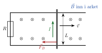

<!-- video: kommer (videoer/ingeniorfysikk/17-02-bevegelses-emf) -->
{fig-alt="Video kommer"}

<!-- tillegg: Claude -->
Når en leder beveger seg gjennom et magnetfelt, blir ladningene i den dratt med. Hver ladning får en magnetisk kraft $q\vec v\times\vec B$, som skyver ladningene langs lederen. Resultatet er en spenning – en **bevegelsesindusert emf**. Det klassiske eksempelet er en stang som glir på to skinner.

## Stang på skinner

{.tikz-fig style="width:460px"}

<!-- tillegg: Claude -->
Vi kan finne spenningen på to måter, og de gir samme svar:

**Med Faradays lov.** Kretsen (skinnene, stanga og motstanden) omslutter arealet $A = Lx$, der $x$ er avstanden til stanga. Når stanga flytter seg, øker arealet med $L\,\mathrm{d}x$, og fluksen med $BL\,\mathrm{d}x$:
$$
\mathcal E = \frac{\mathrm{d}\Phi_B}{\mathrm{d}t} = BL\frac{\mathrm{d}x}{\mathrm{d}t} = BLv
$$

**Med kraften på ladningene.** En ladning i stanga får kraften $qvB$ langs stanga. Arbeidet per ladning langs hele stanga er $vBL$ – og arbeid per ladning er nettopp emf.

::: {.callout-important title="Bevegelsesindusert emf"}
<!-- tillegg: Claude -->
$$
\mathcal E = BLv
$$
når stanga, farten og feltet står vinkelrett på hverandre. Generelt: $\mathcal E = \int(\vec v\times\vec B)\cdot\mathrm{d}\vec l$.
:::

## Strøm, kraft og effekt

<!-- tillegg: Claude -->
Med resistansen $R$ i kretsen går strømmen $I = BLv/R$. Strømmen i stanga ligger i magnetfeltet og får kraften $F = ILB$. Med Lenz' lov peker kraften **mot** bevegelsen (se figuren):
$$
F_B = ILB = \frac{B^2L^2v}{R}
$$
For å holde farten konstant må vi dra i stanga med like stor kraft. Effekten vi leverer, er
$$
P = F_Bv = \frac{B^2L^2v^2}{R} = I^2R
$$
– nøyaktig den effekten som blir til varme i motstanden. Det mekaniske arbeidet blir til elektrisk energi. Det er dette som skjer i en generator.

::: {.eksempel}
<!-- tillegg: Claude -->
**Eksempel: Stang på skinner.** En stang med lengde $0.50\ \mathrm{m}$ dras med konstant fart $4.0\ \mathrm{m/s}$ i et felt på $0.80\ \mathrm{T}$. Resistansen i kretsen er $2.0\ \Omega$. Finn emf, strøm, bremsekraft og effekt.

::: {.losning}
$$
\mathcal E = BLv = 0.80\cdot0.50\cdot4.0\ \mathrm{V} = \underline{\underline{1.6\ \mathrm{V}}}, \qquad I = \frac{\mathcal E}{R} = \underline{\underline{0.80\ \mathrm{A}}}
$$
$$
F_B = ILB = 0.80\cdot0.50\cdot0.80\ \mathrm{N} = \underline{\underline{0.32\ \mathrm{N}}}, \qquad P = F_Bv = \underline{\underline{1.3\ \mathrm{W}}}
$$
Sjekk: $I^2R = 0.80^2\cdot2.0\ \mathrm{W} = 1.3\ \mathrm{W}$. ✓
:::
:::

## Oppbremsing

<!-- tillegg: Claude -->
Gir vi stanga et dytt og slipper den, bremser magnetkraften den ned. Newtons andre lov gir
$$
m\frac{\mathrm{d}v}{\mathrm{d}t} = -\frac{B^2L^2}{R}v \quad\Rightarrow\quad v(t) = v_0\,\mathrm{e}^{-t/\tau}, \qquad \tau = \frac{mR}{B^2L^2}
$$
Farten avtar eksponentielt – jo sterkere felt, desto raskere. Dette er prinsippet bak **virvelstrømsbremser** i tog og fritt-fall-tårn: De bremser uten slitasje, og hardere jo fortere det går.

```{.python .kjor}
import numpy as np
import matplotlib.pyplot as plt
m, R, B, L, v0 = 0.020, 2.0, 0.80, 0.50, 4.0   # kg, ohm, T, m, m/s
tau = m*R/(B*L)**2

# Euler-metoden: m dv/dt = -B^2 L^2 v / R
dt, t, v, x = 1e-4, [0.0], [v0], [0.0]
while t[-1] < 1.5:
    a = -(B*L)**2*v[-1]/(m*R)
    v.append(v[-1] + a*dt); x.append(x[-1] + v[-2]*dt); t.append(t[-1] + dt)

plt.plot(t, v, label="numerisk")
plt.plot(t, v0*np.exp(-np.array(t)/tau), "--", label=r"$v_0\,e^{-t/\tau}$")
plt.xlabel("$t$ (s)"); plt.ylabel("$v$ (m/s)"); plt.legend(); plt.show()
print(f"tau = {tau:.2f} s, stanga stopper etter {x[-1]:.2f} m  (teori: v0*tau = {v0*tau:.2f} m)")
```

:::: {.oppgaver}

::: {.oppgave tittel="Flyvinge"}
<!-- tillegg: Claude -->
Et fly med vingespenn $60\ \mathrm{m}$ flyr vannrett med $250\ \mathrm{m/s}$. Den loddrette komponenten av jordas felt er $4.0\cdot10^{-5}\ \mathrm{T}$. Hvor stor spenning induseres mellom vingespissene? Kan den drive en lampe?

::: {.fasit}
$0.60\ \mathrm{V}$
:::
:::

::: {.oppgave tittel="Hvilken vei?"}
<!-- tillegg: Claude -->
I figuren øverst dras stanga mot **venstre** i stedet. Hvilken vei går strømmen i stanga, og hvilken vei peker magnetkraften?

:::

::: {.oppgave tittel="Fallende stang" niva="Middels"}
<!-- tillegg: Claude -->
Skinnene står nå **loddrett**, og stanga ($m = 20\ \mathrm{g}$, $L = 0.50\ \mathrm{m}$) faller langs dem uten friksjon. Feltet er $0.80\ \mathrm{T}$ og står vinkelrett på planet til skinnene. Resistansen er $2.0\ \Omega$. Finn terminalfarten.

::: {.fasit}
$2.5\ \mathrm{m/s}$
:::
:::

::: {.oppgave tittel="Hvor langt glir den?" niva="Utfordrende"}
<!-- tillegg: Claude -->
Stanga fra avsnittet om oppbremsing får startfarten $v_0$ og slippes. Vis at den glir strekningen $s = v_0\tau$ før den stopper. Hvor stor andel av startenergien er blitt varme i motstanden?

:::

::::
