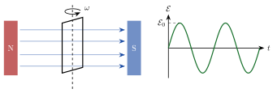

<!-- video: kommer (videoer/ingeniorfysikk/17-03-generator-og-motor) -->
{fig-alt="Video kommer"}

<!-- tillegg: Claude -->
Nesten all elektrisk energi i verden lages ved at en spole dreier i et magnetfelt – i vannkraftverk, vindturbiner og gasskraftverk. Og nesten all elektrisk energi som blir til bevegelse, går gjennom en elektromotor. Generatoren og motoren er den samme maskinen, kjørt hver sin vei.

## Vekselstrømsgeneratoren

{.tikz-fig style="width:540px"}

<!-- tillegg: Claude -->
En spole med $N$ vindinger og areal $A$ dreier med konstant vinkelfart $\omega$ i et homogent felt $B$. Vinkelen mellom feltet og normalen til spolen er $\theta = \omega t$, så fluksen er
$$
\Phi_B = BA\cos(\omega t)
$$
Faradays lov gir

::: {.callout-important title="Generatorspenning"}
<!-- tillegg: Claude -->
$$
\mathcal E = NBA\omega\sin(\omega t) = \mathcal E_0\sin(\omega t), \qquad \mathcal E_0 = NBA\omega
$$
:::

<!-- tillegg: Claude -->
Spenningen er størst når spolen ligger **langs** feltet (fluksen er null, men endrer seg raskest), og null når spolen står vinkelrett på feltet (fluksen er størst, men endrer seg ikke). Spenningen skifter fortegn to ganger per omdreining: Det er **vekselspenning**. I Norge er frekvensen $50\ \mathrm{Hz}$.

::: {.eksempel}
<!-- tillegg: Claude -->
**Eksempel: Generator.** En generator har $100$ vindinger med areal $0.010\ \mathrm{m^2}$, i et felt på $0.50\ \mathrm{T}$, og dreier $50$ ganger i sekundet. Finn toppspenningen.

::: {.losning}
$$
\omega = 2\pi f = 314\ \mathrm{s^{-1}}, \qquad \mathcal E_0 = NBA\omega = 100\cdot0.50\cdot0.010\cdot314\ \mathrm{V} = \underline{\underline{157\ \mathrm{V}}}
$$
:::
:::

::: {.callout-note title="Hvorfor er det tungt å sykle med lyset på?" .graa}
<!-- tillegg: Claude -->
Så lenge ingen strøm går, dreier generatoren lett. Når lampa er koblet til, går det strøm i spolen, og strømmen i magnetfeltet gir et dreiemoment som **motvirker** rotasjonen (Lenz' lov). Effekten du tråkker inn, $\tau\omega$, er lik den elektriske effekten $\mathcal EI$.
:::

## Motor og mot-emf

<!-- tillegg: Claude -->
I en motor sender vi strøm gjennom spolen, og dreiemomentet på strømsløyfa (se *dreiemoment på strømsløyfe*) får den til å rotere. Men en spole som roterer i et magnetfelt, er jo en generator! Motoren induserer derfor en spenning som motvirker den påtrykte spenningen: **mot-emf**, $\mathcal E_\text{mot}$. Strømmen gjennom motoren er
$$
I = \frac{V - \mathcal E_\text{mot}}{R}
$$
der $R$ er resistansen i viklingene. Mot-emf er proporsjonal med turtallet.

::: {.kort}
- **Ved start** står motoren stille, $\mathcal E_\text{mot} = 0$, og strømmen er stor: $I = V/R$. Derfor blinker lyset når en stor motor starter.
- **Uten last** går motoren så fort at $\mathcal E_\text{mot}$ nesten er lik $V$. Strømmen blir liten.
- **Med last** går motoren saktere, $\mathcal E_\text{mot}$ synker, og strømmen øker. Motoren tar selv mer strøm når den må jobbe hardere.
- **Fastkjørt motor** får full startstrøm hele tiden – og kan brenne opp.
:::

::: {.eksempel}
<!-- tillegg: Claude -->
**Eksempel: Likestrømsmotor.** En motor på $12\ \mathrm{V}$ har viklingsresistans $2.0\ \Omega$. Ved fullt turtall er mot-emf $10\ \mathrm{V}$. Finn startstrømmen og strømmen ved fullt turtall. Hvor stor del av effekten blir mekanisk arbeid?

::: {.losning}
$$
I_\text{start} = \frac{12}{2.0}\ \mathrm{A} = \underline{\underline{6.0\ \mathrm{A}}}, \qquad I = \frac{12-10}{2.0}\ \mathrm{A} = \underline{\underline{1.0\ \mathrm{A}}}
$$
Tilført effekt er $VI = 12\ \mathrm{W}$. Mekanisk effekt er $\mathcal E_\text{mot}I = 10\ \mathrm{W}$, og $I^2R = 2\ \mathrm{W}$ blir varme. Andelen er $\underline{\underline{83\,\%}}$.
:::
:::

## Virvelstrømmer

<!-- tillegg: Claude -->
Induksjon skjer ikke bare i ledninger. I en metallplate i et endrende magnetfelt går det strømmer i sløyfer inni metallet – **virvelstrømmer**. De kan være nyttige eller plagsomme:

::: {.kort}
- **Induksjonstopp:** En spole under glassplata fører vekselstrøm. Virvelstrømmene i bunnen av kjelen varmer den opp, mens selve plata holder seg nesten kald.
- **Virvelstrømsbrems:** En metallplate som beveger seg forbi en magnet, bremses (se *bevegelsesindusert emf*).
- **Metalldetektor:** Virvelstrømmene i metallet lager et felt som detektoren registrerer.
- **Tap i transformatorer:** Virvelstrømmer i jernkjernen gir varmetap. Derfor bygges kjernen av tynne, isolerte plater.
:::

:::: {.oppgaver}

::: {.oppgave tittel="Dobbel fart"}
<!-- tillegg: Claude -->
Hva skjer med toppspenningen og frekvensen fra en generator hvis den dreier dobbelt så fort?

:::

::: {.oppgave tittel="Antall vindinger"}
<!-- tillegg: Claude -->
En generator skal gi toppspenningen $325\ \mathrm{V}$ ved $50\ \mathrm{Hz}$. Feltet er $0.40\ \mathrm{T}$ og spolearealet $0.030\ \mathrm{m^2}$. Hvor mange vindinger trengs?

::: {.fasit}
$N = 87$
:::
:::

::: {.oppgave tittel="Motor med last" niva="Middels"}
<!-- tillegg: Claude -->
En motor på $230\ \mathrm{V}$ har viklingsresistans $5.0\ \Omega$ og trekker $4.0\ \mathrm{A}$ ved normal drift. Finn mot-emf og mekanisk effekt. Hva blir strømmen hvis motoren kjører seg fast?

::: {.fasit}
$210\ \mathrm{V}$ · $840\ \mathrm{W}$ · $46\ \mathrm{A}$
:::
:::

::: {.oppgave tittel="Dreiemoment på generatoren" niva="Utfordrende"}
<!-- tillegg: Claude -->
Generatoren fra eksempelet ($\mathcal E_0 = 157\ \mathrm{V}$, $f = 50\ \mathrm{Hz}$) er koblet til en motstand på $50\ \Omega$. Finn gjennomsnittlig elektrisk effekt og det gjennomsnittlige dreiemomentet som må til for å holde den i gang. Se bort fra resistansen i spolen.

::: {.fasit}
<!-- tillegg: Claude: notasjon, gjeldende siffer (50 Ω har 2) -->
$2.5\cdot10^{2}\ \mathrm{W}$ · $0.78\ \mathrm{N\,m}$
:::
:::

::::
