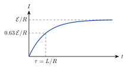

<!-- video: kommer (videoer/ingeniorfysikk/17-04-induktans) -->
{fig-alt="Video kommer"}

<!-- tillegg: Claude -->
En spole med strøm lager sitt eget magnetfelt, og dermed sin egen fluks. Endrer strømmen seg, endrer fluksen seg – og spolen induserer en spenning i **seg selv**. Etter Lenz' lov motvirker spenningen endringen. En spole er derfor «treg»: Den prøver å holde strømmen konstant, omtrent som en masse prøver å holde farten konstant.

## Selvinduktans

<!-- tillegg: Claude -->
Fluksen gjennom spolen er proporsjonal med strømmen. Proporsjonalitetskonstanten kalles **induktansen** $L$:

::: {.callout-note title="Definisjon: induktans"}
<!-- tillegg: Claude -->
$$
N\Phi_B = LI, \qquad \mathcal E = -L\frac{\mathrm{d}I}{\mathrm{d}t}
$$
Enheten er **henry**: $1\ \mathrm{H} = 1\ \mathrm{V\,s/A}$. En spole med $1\ \mathrm{H}$ gir $1\ \mathrm{V}$ når strømmen endrer seg med $1\ \mathrm{A}$ per sekund.
:::

<!-- tillegg: Claude -->
Induktansen avhenger bare av formen på spolen (og materialet inni), ikke av strømmen – akkurat som kapasitansen bare avhenger av formen på kondensatoren.

**Induktansen til en lang solenoide.** Med $N$ vindinger, lengde $\ell$ og tverrsnitt $A$ er feltet $B = \mu_0NI/\ell$ (se *solenoide*), og fluksen gjennom hver vinding $BA$:
$$
L = \frac{N\Phi_B}{I} = \frac{\mu_0N^2A}{\ell}
$$
Induktansen vokser med $N^2$: Dobbelt så mange vindinger gir dobbelt så mye felt, **og** dobbelt så mange vindinger som feltet går gjennom.

::: {.eksempel}
<!-- tillegg: Claude -->
**Eksempel: Solenoide.** En solenoide har $500$ vindinger på $25\ \mathrm{cm}$ og tverrsnitt $10\ \mathrm{cm^2}$. Finn induktansen og spenningen når strømmen øker jevnt med $100\ \mathrm{A/s}$.

::: {.losning}
$$
L = \frac{\mu_0N^2A}{\ell} = \frac{4\pi\cdot10^{-7}\cdot500^2\cdot1.0\cdot10^{-3}}{0.25}\ \mathrm{H} = \underline{\underline{1.3\ \mathrm{mH}}}
$$
$$
|\mathcal E| = L\frac{\mathrm{d}I}{\mathrm{d}t} = 1.26\cdot10^{-3}\cdot100\ \mathrm{V} = \underline{\underline{0.13\ \mathrm{V}}}
$$
:::
:::

## Energi i en spole

<!-- tillegg: Claude -->
For å bygge opp strømmen må vi arbeide mot den induserte spenningen. Effekten er $P = LI\,\frac{\mathrm{d}I}{\mathrm{d}t}$, og arbeidet fra $0$ til $I$ blir

::: {.callout-important title="Energi lagret i en spole"}
<!-- tillegg: Claude -->
$$
U = \tfrac12 LI^2 \qquad\text{og energitettheten i magnetfeltet:}\qquad u_B = \frac{B^2}{2\mu_0}
$$
:::

<!-- tillegg: Claude -->
Sammenlign med kondensatoren, $U = \tfrac12CV^2$ og $u_E = \tfrac12\varepsilon_0E^2$. Kondensatoren lagrer energi i det elektriske feltet, spolen i det magnetiske. Energien ligger i **feltet**, ikke i ledningene.

::: {.eksempel}
<!-- tillegg: Claude -->
**Eksempel: Energi i MR-feltet.** Hvor mye energi per kubikkmeter er lagret i et felt på $1.5\ \mathrm{T}$?

::: {.losning}
$$
u_B = \frac{B^2}{2\mu_0} = \frac{1.5^2}{2\cdot4\pi\cdot10^{-7}}\ \mathrm{J/m^3} = \underline{\underline{9.0\cdot10^{5}\ \mathrm{J/m^3}}}
$$
Nesten en megajoule per kubikkmeter. Mister magneten superledningen, blir energien til varme på sekunder, og heliumet koker bort.
:::
:::

## RL-kretsen

{.tikz-fig style="width:340px"}

<!-- tillegg: Claude -->
Lukker vi bryteren, kan strømmen ikke hoppe opp med en gang – spolen motvirker endringen. Kirchhoffs spenningslov gir
$$
\mathcal E - RI - L\frac{\mathrm{d}I}{\mathrm{d}t} = 0
$$
Dette er samme type differensialligning som for RC-kretsen, og løsningen er

::: {.callout-important title="Strømmen i en RL-krets"}
<!-- tillegg: Claude -->
$$
I(t) = \frac{\mathcal E}{R}\left(1 - \mathrm{e}^{-t/\tau}\right), \qquad \tau = \frac LR
$$
Kobles kilden ut (og kretsen lukkes gjennom motstanden), avtar strømmen som $I_0\mathrm{e}^{-t/\tau}$.
:::

{.tikz-fig style="width:380px"}

<!-- tillegg: Claude -->
Like etter at bryteren er lukket, oppfører spolen seg som et **brudd** (ingen strøm). Lenge etterpå oppfører den seg som en **ledning** (ingen spenning over den). Det er motsatt av kondensatoren.

::: {.eksempel}
<!-- tillegg: Claude -->
**Eksempel: RL-krets.** En spole på $0.50\ \mathrm{H}$ og en motstand på $10\ \Omega$ kobles til $12\ \mathrm{V}$. Finn tidskonstanten, sluttstrømmen, strømmen etter én tidskonstant og energien i spolen til slutt.

::: {.losning}
$$
\tau = \frac LR = \underline{\underline{0.050\ \mathrm{s}}}, \qquad I_\infty = \frac{\mathcal E}{R} = \underline{\underline{1.2\ \mathrm{A}}}, \qquad I(\tau) = 0.63\cdot1.2\ \mathrm{A} = \underline{\underline{0.76\ \mathrm{A}}}
$$
$$
U = \tfrac12LI_\infty^2 = \tfrac12\cdot0.50\cdot1.2^2\ \mathrm{J} = \underline{\underline{0.36\ \mathrm{J}}}
$$
:::
:::

```{.python .kjor}
import numpy as np
import matplotlib.pyplot as plt
E, R, L = 12.0, 10.0, 0.50
tau = L/R
t = np.linspace(0, 5*tau, 400)
I = E/R*(1 - np.exp(-t/tau))
VL = E*np.exp(-t/tau)                     # spenningen over spolen
fig, ax = plt.subplots(1, 2, figsize=(9, 3.5))
ax[0].plot(t*1000, I); ax[0].set_xlabel("$t$ (ms)"); ax[0].set_ylabel("$I$ (A)")
ax[1].plot(t*1000, VL, c="C3"); ax[1].set_xlabel("$t$ (ms)"); ax[1].set_ylabel("$V_L$ (V)")
plt.tight_layout(); plt.show()
```

::: {.callout-warning title="Gnisten når du bryter strømmen"}
<!-- tillegg: Claude -->
Bryter du strømmen gjennom en spole brått, blir $\mathrm{d}I/\mathrm{d}t$ enorm, og spolen induserer en svært høy spenning. Det kan gi en gnist i bryteren eller ødelegge elektronikk. Derfor settes en diode i parallell med releer og motorer, så strømmen har et sted å gå. Den samme effekten brukes med vilje i tennspolen i en bensinmotor.
:::

:::: {.oppgaver}

::: {.oppgave tittel="Indusert spenning"}
<!-- tillegg: Claude -->
Strømmen gjennom en spole på $0.50\ \mathrm{H}$ brytes fra $1.2\ \mathrm{A}$ til null på $1.0\ \mathrm{ms}$. Hvor stor spenning induseres?

::: {.losning}
$$
|\mathcal E| = L\frac{\Delta I}{\Delta t} = 0.50\cdot\frac{1.2}{1.0\cdot10^{-3}}\ \mathrm{V} = \underline{\underline{600\ \mathrm{V}}}
$$
Femti ganger batterispenningen – nok til en gnist.
:::
:::

::: {.oppgave tittel="Flere vindinger"}
<!-- tillegg: Claude -->
Hva skjer med induktansen til en solenoide hvis du dobler antall vindinger på samme lengde? Hva skjer med den lagrede energien ved samme strøm?

::: {.losning}
$L \propto N^2$: Induktansen blir **4 ganger** så stor, og med $U = \tfrac12LI^2$ blir også energien **4 ganger** så stor (feltet er dobbelt, og $u_B \propto B^2$).
:::
:::

::: {.oppgave tittel="Halveringstid" niva="Middels"}
<!-- tillegg: Claude -->
I RL-kretsen fra eksempelet kobles kilden ut, og strømmen avtar gjennom motstanden. Hvor lang tid tar det før strømmen er halvert? Hvor lang tid før energien i spolen er halvert?

::: {.losning}
Strømmen: $\mathrm{e}^{-t/\tau} = \tfrac12$ gir $t = \tau\ln2 = 0.050\cdot0.693\ \mathrm{s} = \underline{\underline{35\ \mathrm{ms}}}$.

Energien går som $I^2 \propto \mathrm{e}^{-2t/\tau}$, så den halveres dobbelt så fort: $t = \tfrac12\tau\ln2 = \underline{\underline{17\ \mathrm{ms}}}$.
:::
:::

::: {.oppgave tittel="Energitetthet i solenoiden" niva="Utfordrende"}
<!-- tillegg: Claude -->
Vis at $U = \tfrac12LI^2$ for en lang solenoide er det samme som $u_B$ ganget med volumet inni solenoiden. Sjekk med tallene fra solenoide-eksempelet ved strømmen $2.0\ \mathrm{A}$.

::: {.losning}
Med $L = \mu_0N^2A/\ell$ og $B = \mu_0NI/\ell$:
$$
\tfrac12LI^2 = \frac{\mu_0N^2AI^2}{2\ell} = \frac{1}{2\mu_0}\left(\frac{\mu_0NI}{\ell}\right)^2 A\ell = \frac{B^2}{2\mu_0}\cdot A\ell \quad ✓
$$
Tall: $U = \tfrac12\cdot1.26\cdot10^{-3}\cdot2.0^2\ \mathrm{J} = \underline{\underline{2.5\ \mathrm{mJ}}}$. Og $B = 5.0\ \mathrm{mT}$ gir $u_B = 10\ \mathrm{J/m^3}$, ganget med volumet $2.5\cdot10^{-4}\ \mathrm{m^3}$: $2.5\ \mathrm{mJ}$. ✓
:::
:::

::::
